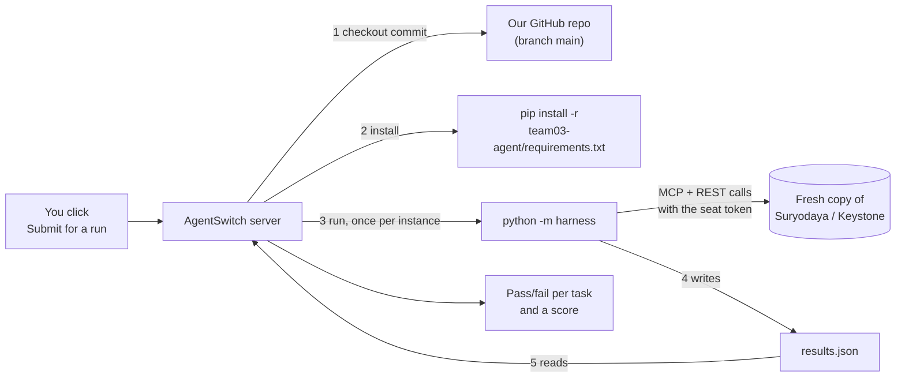
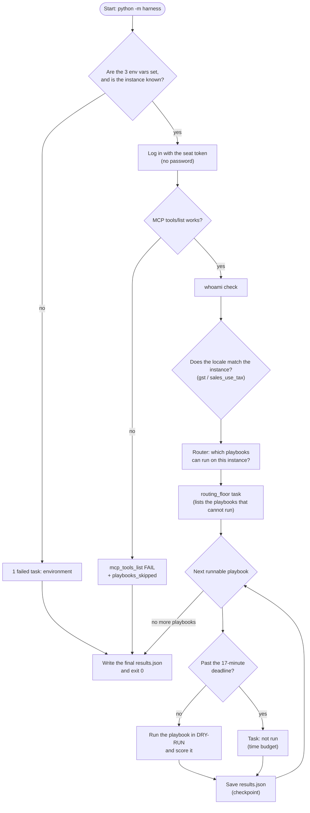
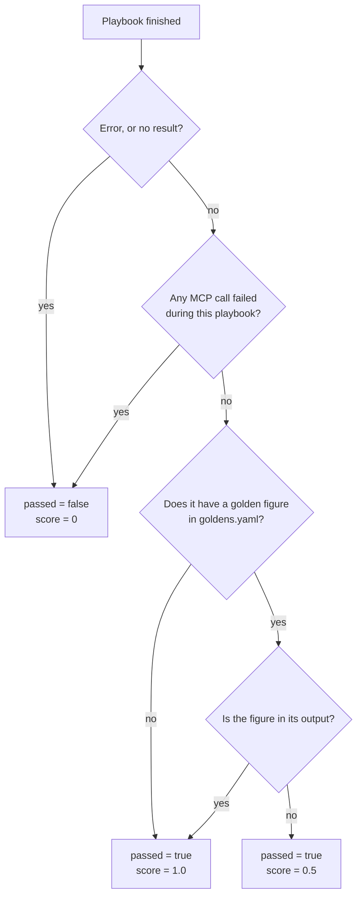
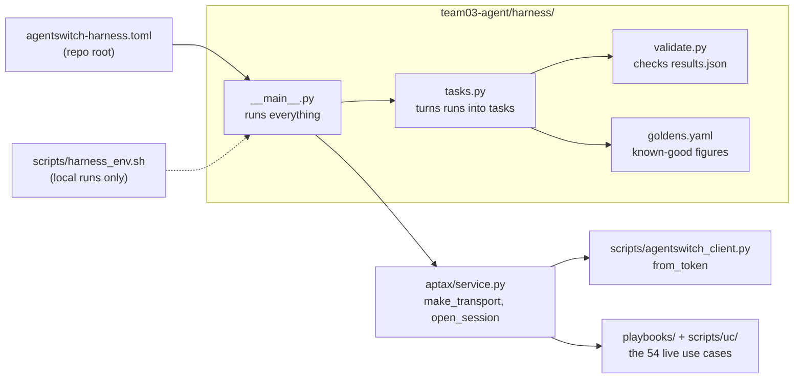
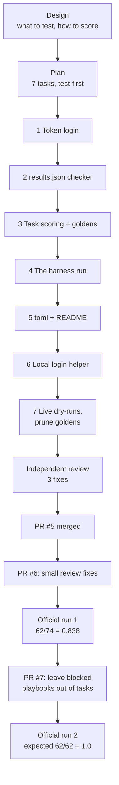
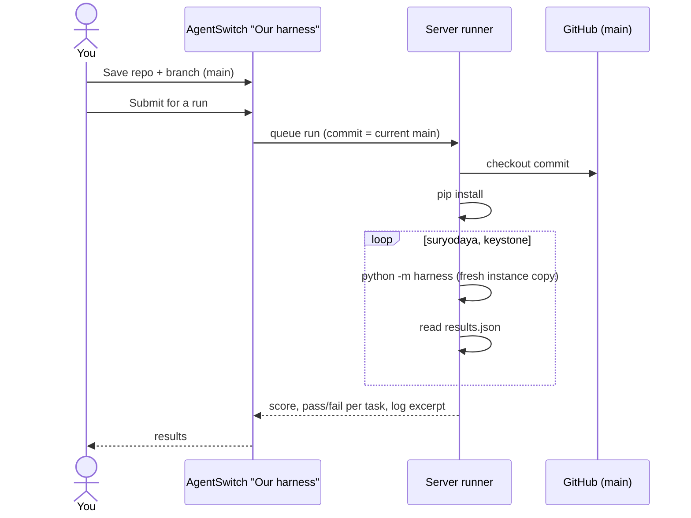

# The AgentSwitch harness — explained

This guide is for anyone on Team 03, or anyone helping us, who wants to understand our
harness: what it is, how it works, how we built it, and how to run it. You don't need to
have read the code first.

**In one sentence:** the harness is a small program that the AgentSwitch class server
runs against our repo to check how well our agent (`aptax`) works on the live ledgers. It
reports one pass/fail result per use case, and the server turns those results into a score.

---

## 1. What is a harness?

Think of a driving test. You don't tell the examiner how good a driver you are: they put
you in a car on a real road, watch you drive a fixed route, and tick a box for each
manoeuvre.

The harness does the same for our agent:

| Driving test | Our harness |
|---|---|
| The examiner | The AgentSwitch server (Release 8.1, "Our harness → Submit for a run") |
| The car and the road | A **fresh copy** of a business's ledger (Suryodaya in India, Keystone in the US) |
| The route | Every use case (playbook) our agent can run, such as duplicate payments or tax liability |
| The ticked boxes | `results.json`: one task per playbook, `passed: true/false`, plus a score |

The instructor's rules:

- The server checks out **the exact commit** on the branch we saved, installs our
  dependencies, and runs our command **once per instance** we list.
- Each run uses a **fresh copy** of the instance, and anything we write is thrown away.
- Our command must write `results.json` in a fixed format.
- **One run per team every 3 days**, and each run has a 20-minute limit. There is **no
  internet** while it runs.
- We may **only** use what the server gives us: no passwords, no `.env`, no API keys of
  our own.

---

## 2. The big picture



The whole contract lives in one file at the root of the repo,
[`agentswitch-harness.toml`](../../agentswitch-harness.toml):

```toml
install = "pip install -r team03-agent/requirements.txt"
run     = "cd team03-agent && python -m harness"
results = "team03-agent/results.json"
instances = ["suryodaya", "keystone"]
timeout_minutes = 20
```

### What the server gives us

| Variable | What it is | How we use it |
|---|---|---|
| `AGENTSWITCH_BASE_URL` | The instance's address | Every MCP / REST call |
| `AGENTSWITCH_TOKEN` | Our seat's login token | `Authorization: Bearer …`, so no password is needed |
| `AGENTSWITCH_INSTANCE` | `suryodaya` or `keystone` | Picks the tenant (`in` or `us`) and the expected tax regime |
| `OPENAI_*` | The class's LLM | **Not used.** Our playbooks are deterministic: no LLM, so no randomness |

---

## 3. What one run does, step by step



In plain words:

1. **Check the environment.** If a variable is missing, or the instance name is unknown,
   we still write a valid `results.json` with one failed task that explains why.
2. **Log in with the token.** aptax normally logs in with an email and password. The
   harness instead uses the token the server gives it (`make_transport()` prefers
   `{prefix}_TOKEN`).
3. **Platform checks** (3 tasks):
   - `mcp_tools_list`: MCP answers and lists its tools.
   - `whoami`: the token belongs to a real user.
   - `locale_matches_instance`: Suryodaya reports `gst` and Keystone reports
     `sales_use_tax`.
4. **Routing.** Each playbook has a manifest saying which tax regime, data and tools it
   needs. The router decides which ones can run here.
   - Playbooks for **the other country** are ignored completely.
   - Playbooks that are **blocked or spec-only** for this country are not tasks. Their
     ids are listed in the `routing_floor` task's evidence.
   - `routing_floor` passes if at least the expected number of playbooks can run (36 on
     Suryodaya, 18 on Keystone). This catches a silent breakage that would quietly skip
     use cases.
5. **Run each playbook, one at a time, in dry-run.** The playbook reads the ledger,
   computes its findings and never writes. One playbook failing never stops the others.
6. **Checkpoint after every playbook.** `results.json` is saved again after each
   playbook. If the server kills us at 20 minutes, it still finds a valid, partial file.
7. **Finish.** The harness writes the final file, prints one `[PASS]`/`[FAIL]` line per
   task to the log, and always exits with code 0. Pass or fail lives in the file, not in
   the exit code.

---

## 4. How a playbook task is judged

Each runnable playbook becomes one task, judged in two parts:

- **`passed`**: did it run cleanly?
- **`score`**: did it get the answer we already know to be right?



**What is a "golden figure"?** It's a number we checked by hand against the spec's
worked example. For instance, Keystone's year-to-date sales tax is **$226,488.27**, which
matches the platform's own report to the cent. These live in
[`harness/goldens.yaml`](../harness/goldens.yaml):

```yaml
uc-26: ["45,152.62"]     # wrong-head GST
uc-41: ["4,91,099.27"]   # open vendor credits to apply
uc-43: ["56,20,600"]     # bank-to-AP gaps
us-01: ["226,488.27"]    # sales tax liability YTD
us-05: ["7,919.93"]      # wrong county tax
```

**Why a figure that doesn't match gives 0.5 and not a failure:** the server runs against a
*fresh copy* of the ledger, and its data can differ from the live ledger we developed
against. A figure that drifts is worth knowing about, but it doesn't mean the playbook is
broken. So drift lowers the score, and the task never turns red.

> Golden figures are tied to the current period. UC-23's August figure (₹5,72,073.68) was
> removed because, in September, the playbook reports September (₹0.00). After a month
> rollover, a period-based figure may drop to 0.5 until it is refreshed.

An example task in `results.json`:

```json
{
  "id": "keystone:us-01",
  "title": "Period sales and use tax liability",
  "passed": true,
  "score": 1.0,
  "evidence": "golden 226,488.27: found · findings=6 · 2026-01-01 … 2026-10-12: sales tax liability $226,488.27 across 4 jurisdiction(s), matching the platform's liability report to the cent …"
}
```

---

## 5. The files



| File | Job |
|---|---|
| [`agentswitch-harness.toml`](../../agentswitch-harness.toml) | Tells the server how to install, run and find results |
| [`harness/__main__.py`](../harness/__main__.py) | The run itself: env check, platform checks, routing, the playbook loop, checkpoints, the deadline |
| [`harness/tasks.py`](../harness/tasks.py) | Pure functions: turn a playbook run into a task, check golden figures, final tidy-up (unique ids, 500-character evidence, at most 200 tasks) |
| [`harness/validate.py`](../harness/validate.py) | Checks a `results.json` against the instructor's format: `python -m harness.validate results.json` |
| [`harness/goldens.yaml`](../harness/goldens.yaml) | Known-good figures per playbook |
| [`scripts/harness_env.sh`](../scripts/harness_env.sh) | Local helper: logs in and sets the same three variables the server sets |
| [`aptax/service.py`](../aptax/service.py) | `make_transport()` uses the token when one is set; otherwise email/password as before |
| [`tests_generated/harness_tests/`](../tests_generated/harness_tests/) | 79 offline tests, which never touch the network. These are **LLM-generated and ungraded**, so they are kept out of `tests/` |

---

## 6. How we built it, step by step

We followed a design → plan → build → review process. The design lives in
[`superpowers/specs/2026-10-12-agentswitch-harness-design.md`](superpowers/specs/2026-10-12-agentswitch-harness-design.md),
and the plan in [`superpowers/plans/2026-10-12-agentswitch-harness.md`](superpowers/plans/2026-10-12-agentswitch-harness.md).



**Step 1: Design the approach.** We chose to run our **deterministic playbooks** rather
than an LLM agent, so results don't vary from run to run. We chose **hybrid scoring**:
`passed` means the playbook ran cleanly, and `score` means it got the known answer.

**Step 2: Token login** ([PR #5](https://github.com/spatil1985/EAGV3_Capstone_AP_tax/pull/5)).
The server gives a token, not a password. We added `AgentSwitchClient.from_token()`, and
`make_transport()` now uses `{prefix}_TOKEN` when it is set.

**Step 3: A results checker.** `harness/validate.py` checks the instructor's format
(1–200 tasks, `passed` is a boolean, `score` is between 0 and 1, and so on). We get one
official run every 3 days, so we check the format locally first.

**Step 4: Task scoring.** `harness/tasks.py` turns each playbook run into a task, matches
golden figures, and tidies the final list.

**Step 5: The harness run.** `harness/__main__.py` puts it all together: it maps the
instance to a tenant, runs the platform checks, routes, runs each playbook in dry-run,
applies the 17-minute deadline, and always writes the file.

**Step 6: Server config.** We added `agentswitch-harness.toml` at the repo root and listed
`results.json` in `.gitignore`.

**Step 7: The local login helper.** `scripts/harness_env.sh` reads your password from
`.env`, logs in with curl, and sets the same variables the server would. The password is
sent on stdin, so it never appears on a command line, and the script prints only the
first 8 characters of the token.

**Step 8: Live dry-runs.** We ran the harness against both real instances. Every runnable
playbook passed. UC-23's golden figure was out of date (August versus September), so we
removed it.

**Step 9: Independent review.** A fresh reviewer read the whole change and found three
ways we could lose an entire official run. We fixed all three:

| Risk | Fix |
|---|---|
| The server might use Python 3.10, which has no `datetime.UTC`, so everything would crash | Use `timezone.utc` in 5 aptax files |
| A playbook result that can't be scored would lose every later playbook | Each playbook is now isolated, and the golden check tolerates odd data |
| Being killed at 20 minutes would leave no `results.json` | Save the file after every playbook |

**Step 10: Small fixes** ([PR #6](https://github.com/spatil1985/EAGV3_Capstone_AP_tax/pull/6)).
The instance name is now case-insensitive, the deadline counts from process start, and
the helper reads `.env` the same way aptax does.

**Step 11: First official run.** Score **0.838 (62/74)**. Every runnable playbook passed;
the 12 failures were playbooks that *cannot* run on these instances (blocked or
spec-only).

**Step 12: Leave blocked playbooks out**
([PR #7](https://github.com/spatil1985/EAGV3_Capstone_AP_tax/pull/7)). Those 12 are now
listed inside the `routing_floor` evidence instead of counting as failures. A live
dry-run gives **40/40 and 22/22**.

---

## 7. Run it yourself (local)

You need the seat credentials in `team03-agent/.env` (gitignored). Use
[`.env.example`](../.env.example) as the template.

```bash
# from the repo root
source team03-agent/scripts/harness_env.sh suryodaya     # or: keystone
cd team03-agent
python -m harness                                        # takes about 4–7 minutes, dry-run, never writes
python -m harness.validate results.json                  # "results.json: OK (40 tasks)"
```

What you should see:

```
instance=suryodaya user=team03@theschoolofai.in token=AbKvlQIz…
[PASS] suryodaya:mcp_tools_list: 510 tools
[PASS] suryodaya:locale_matches_instance: tax_regime=gst (expected gst)
[PASS] suryodaya:routing_floor: 36 playbooks routed to run (floor 36); not run here (blocked/spec-only): uc-07, …
[PASS] suryodaya:uc-05: findings=11 · 11 candidate duplicate(s) …
…
suryodaya: 40/40 passed · goldens 3/3 exact
```

Afterwards, open a fresh terminal for other `aptax` commands, because the helper points
`AGENTSWITCH_*` at the instance you chose.

Offline tests (no network):

```bash
cd team03-agent && python -m pytest tests_generated/harness_tests -q     # 79 passed
```

---

## 8. Submit an official run



1. Make sure the change you want is **merged into `main`**. Our saved harness is
   `spatil1985/EAGV3_Capstone_AP_tax` on branch `main`.
2. Click **Submit for a run** in "Our harness". You can submit again 3 days after your
   last submission.
3. After about 10 minutes, read the score and the per-task results there.

| Run | Date | Commit | Result |
|---|---|---|---|
| 1 | 2026-10-12 | `0ba9e0f` | 62/74, score 0.838. Every runnable playbook passed; 12 blocked or spec-only playbooks counted as failures |
| 2 | from 2026-10-15 06:43 UTC | `5e13527` | Expected 62/62, score 1.0 (live dry-run) |

---

## 9. FAQ

**Does the harness change the ledger?** No. It runs in dry-run, aptax refuses writes in
code, and the server throws away writes anyway.

**Why no LLM?** Our playbooks are deterministic calculations. Leaving the LLM out gives
the same answer every run. The class model is available (`OPENAI_*`), but we don't need it.

**A golden figure shows "NOT found". Is that a bug?** Not necessarily. Read the summary in
the evidence. If the data or the period has changed, update or remove the figure in
`goldens.yaml`. If the playbook itself failed, that's a real bug: debug it rather than
editing the figure.

**Why are UC-07 / UC-14 not run?** They need a school or clinic tenant, and both of our
instances are manufacturing businesses. Others are blocked by platform gaps; the reason is
in each playbook's manifest under [`../playbooks/`](../playbooks/README.md).

**Where are the tests?** In `tests_generated/harness_tests/`. Tests written by an LLM
score 0 in this capstone, so they are kept apart from the graded `tests/` folder.
